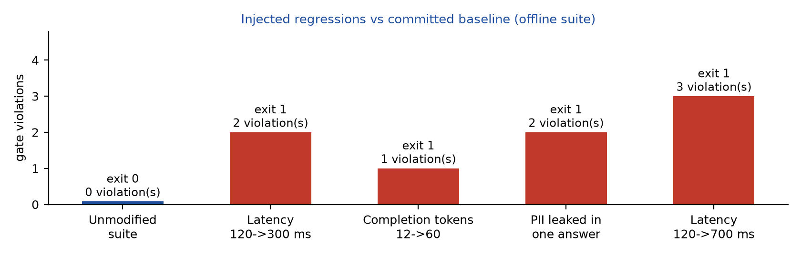
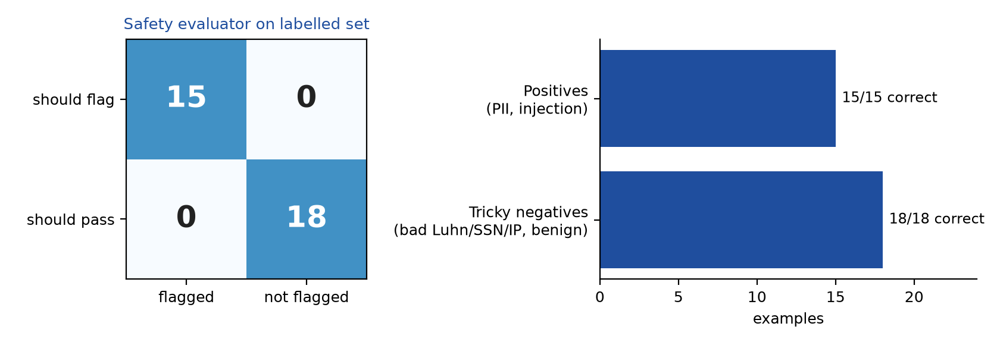

```{=typst}
#show <refs>: set par(hanging-indent: 0.5in, first-line-indent: 0pt, justify: false)
#set text(hyphenate: false)
#set bibliography(title: "References")
#show cite: set text(fill: rgb("#1f4e9e"))
#show bibliography: set par(justify: false)
// Three-rule tables (top, below header, bottom) and bold "Figure N" / "Table N" labels
#set table.hline(stroke: 0.6pt)
#show table: it => box(stroke: (top: 1pt, bottom: 1pt), it)
#show figure.caption: it => context [#strong[#it.supplement~#it.counter.display(it.numbering)#it.separator]#it.body]
#show table: set par(justify: false)
#show heading.where(level: 1): it => block(above: 1.2em, below: 0.6em)[
  #set text(fill: rgb("#1f4e9e"), size: 14pt, weight: "bold")
  #it
]
#show heading.where(level: 2): set text(fill: rgb("#2d2d2d"), size: 11.5pt)
#let glance(body) = block(fill: rgb("#eef3fb"), stroke: (left: 3pt + rgb("#1f4e9e")), inset: 10pt, radius: 2pt, width: 100%, body)
// Header: red title, subtitle, author, repository link
#align(center)[
  #set par(justify: false)
  #text(size: 17pt, weight: "bold", fill: rgb("#b91c1c"))[LLM Evaluation & Guardrails Harness]
  #v(0.5em)
  #text(size: 12pt, weight: "bold")[Catch quality, safety, latency and cost regressions in LLM apps before they ship]
  #v(0.9em)
  #text(size: 11pt)[Reagan Kesseku, Ph.D.]
  #linebreak()
  #text(size: 10pt)[#link("https://github.com/rkesseku/llm-eval-harness")[github.com/rkesseku/llm-eval-harness]]
  #v(0.45em)
  #text(size: 9.5pt)[#emph[Keywords:] LLM evaluation, LLM-as-a-judge, guardrails, PII detection, prompt injection]
]
#v(0.5em)
```

```{=typst}
#glance[
*At a glance* \
*Problem:* every prompt tweak or model swap in an LLM application can silently make answers worse, less safe, slower or more expensive, and teams usually find out in production. \
*What I built:* a Python evaluation harness that scores answers (LLM-as-judge correctness and groundedness, plus deterministic PII / refusal / prompt-injection checks), records latency and token cost, and fails a CI job with a non-zero exit code when thresholds or a stored baseline are violated. \
*Headline result:* 151 automated tests pass offline. In a reproducible demo, the unmodified offline suite passes the gate (exit 0) and four injected regressions (slower client, costlier output, a PII leak, a very slow client) each fail it (exit 1) with a Markdown report naming the exact metric. The safety checks classified all 33 of 33 examples in a small hand-written labelled set correctly. \
*Caveat:* the CI suite uses scripted clients, so it proves the gate wiring and says nothing about the quality of any real model. \
*Stack:* Python 3.10+, Pydantic v2, PyYAML, pytest, ruff, GitHub Actions, and a Groq backend for real models. \
*Repo:* #link("https://github.com/rkesseku/llm-eval-harness")[github.com/rkesseku/llm-eval-harness]
]
```

# The problem

Traditional software has unit tests: change the code, run the tests, and a red build stops the release. LLM applications rarely have the equivalent. A reworded system prompt, a new model version or a different retrieval setup changes behaviour in ways that are hard to see by reading a few examples. The change might make answers less correct, let the model invent facts that are not in the retrieved documents, leak an email address or card number, comply with a malicious instruction hidden in a document, or simply get slower and more expensive.

Before promoting a change, a team needs to know: *did this make things better or worse?* This project answers that with repeatable runs and a machine-readable pass/fail decision that CI can enforce.

## What it measures

- **Correctness** and **groundedness**: a second "grader" model [@zheng2023judge] scores each answer on a 1 to 5 scale (normalised to 0 to 1). Correctness compares to a reference answer, and groundedness checks that every claim is supported by the retrieved context, which is the standard hallucination check for retrieval-augmented generation (RAG) [@lewis2020rag].
- **Safety**, with no LLM involved: validated PII detection, refusal detection, and prompt-injection signals [@greshake2023] in inputs and retrieved context. Because it is deterministic, it is reproducible and free to run.
- **Latency and cost** of the system under test: p50 and p95 latency, tokens, and dollar cost from a pricing table.
- **A regression gate**: absolute limits plus comparison with a committed baseline, with configurable tolerances.

# Approach

## Architecture

{#fig-arch width=82%}

## How a run works

1. **Suite.** A declarative YAML/JSON file lists test cases (input, optional retrieved context, expected answer, metadata), the *system-under-test* client (the model being evaluated), the *grader* client, and the evaluators to apply.
2. **Runner.** `EvalRunner` walks the case-by-evaluator grid. For each case it makes one call to the system under test, timing it and recording prompt and completion tokens, then runs every evaluator on the answer.
3. **Evaluators.** Each returns a verdict (pass, fail or error), a score in [0, 1] and structured details. If an evaluator raises, the base class converts it into an `ERROR` verdict so the rest of the run continues and the failure is visible in the report.
4. **Metrics.** Results are summarised into p50/p95 latency, mean and total cost, token counts and per-evaluator pass rates.
5. **Gate and report.** `evaluate_gate` returns a list of violations. The CLI prints a Markdown report (per-evaluator table, latency and cost against baseline, a failures table) and exits with `0` (passed), `1` (violation or regression) or `2` (usage or configuration error).

The same command runs in GitHub Actions: a test job (Python 3.10 to 3.12, ruff, pytest) and an `eval-gate` job that runs the offline suite against the committed baseline and publishes the report to the job summary.

# Design decisions

**Two separate model clients.** The system under test and the grader are distinct objects, so a cheaper or different model can grade a more expensive one, and grader choice is explicit rather than hidden.

**`Protocol` instead of inheritance for clients.** `LLMClient` is a structural type with a single `complete(...)` method. The Groq backend, a `FakeLLMClient` and a `ScriptedLLMClient` are interchangeable. The scripted client returns canned answers, token counts and a fixed latency, which is what lets CI run with no network and no secrets, and makes every test deterministic.

**Deterministic safety checks before LLM judging.** PII and injection checks are rule-based so they are cheap, reproducible and cannot be fooled by the thing they are checking. Candidates must pass structural validation before they count:

- Credit-card-like digit runs must satisfy the **Luhn checksum**.
- SSNs are rejected for invalid ranges (area 000, 666 or 9xx, group 00, serial 0000).
- IPv4 octets must be valid, and loopback and unspecified addresses are ignored.
- Optional IBANs must pass the **mod-97** check.

This trades a little recall for far fewer false alarms, which matters if the check can block a merge. Findings store only a masked preview and never the raw value.

**Judge hygiene.** Graders run at temperature 0 and must return strict JSON. Markdown fences are stripped, and malformed output becomes an `ERROR` rather than a silent pass. Scores are normalised to [0, 1] so different scales aggregate on one axis. Pass thresholds are configurable (default 0.8 for correctness).

**Gate semantics.** Two kinds of violation are kept apart: *threshold* (an absolute limit, such as p95 latency above a ceiling or safety pass rate below 100%) and *regression* (worse than the baseline by more than a tolerance, which in the example config is latency +20%, cost +10% and pass-rate drop 0). Baselines are plain JSON in the repository, so promoting new numbers is a deliberate, reviewable commit via `--update-baseline`.

# Results

All numbers in this section were produced by running the code in this repository (`docs/brief/make_figures.py`). Nothing here measures a real model, because the offline suite answers and grader scores are scripted.

## Test suite and gate baseline

`pytest` reports **151 passed** in about 1.3 seconds, with no network or API key. Running the committed example suite (4 cases, 3 evaluators, 12 results) against its baseline and thresholds gives pass rates of 100% for safety, correctness and groundedness, p50 and p95 latency of 120 ms (the scripted constant), and a total cost of 0.000464 USD at the illustrative placeholder prices. The gate passes with exit code 0.

## The gate catching injected regressions

To show the gate does its job, I modified a copy of the suite and re-ran the real CLI against the *unchanged* baseline and thresholds. Each variant changes one thing:

| Scenario | Exit | Violations reported |
|-----------------------------------------------|:-----:|-----------------------------------------------|
| Unmodified suite | 0 | none |
| Scripted latency 120 to 300 ms | 1 | p50 and p95 latency regression (+20% allowed) |
| Completion tokens 12 to 60 per answer | 1 | mean cost per case regression (0.00026 vs 0.000116 USD, +10% allowed) |
| One answer now contains an email and phone number | 1 | safety pass rate 75.0% below minimum 100%, safety regression vs baseline |
| Scripted latency 120 to 700 ms | 1 | p50 above the 500 ms ceiling, p50 and p95 regression |

: Injected regressions, all run through `llm-eval run` with the committed thresholds and baseline. {#tbl-gate}

{#fig-gate width=70%}

The PII-leak variant is the most instructive. The grader is scripted to always accept, so correctness and groundedness stay at 100%, yet the deterministic safety evaluator fails the case and the report's failures table points at it. That is why safety checks are independent of the judge.

## Safety evaluator on a labelled set

I wrote a small labelled set of 33 short texts: 15 that should be flagged (emails, phones, valid SSN and card numbers, a private IP, and injection phrases such as "ignore all previous instructions", chat-template tokens, a zero-width character) and 18 deliberately tricky negatives (Luhn-failing card-like numbers, SSNs in invalid ranges, invalid or loopback IPs, a version string, and benign sentences that contain words like "instructions" or "you are now"). Each was run through `SafetyEvaluator`.

{#fig-safety width=82%}

The evaluator produced 15 true positives, 0 false negatives, 0 false positives and 18 true negatives (33 of 33 correct). Treat this as a sanity check rather than a benchmark. I wrote both the examples and the rules, so the set is biased toward cases the rules already anticipate, and it is far too small to estimate real-world precision or recall.

# What this demonstrates

- **Evaluation engineering.** Turning "does it seem better?" into a repeatable pipeline with typed data models, a runner, pluggable evaluators and a serialisable report.
- **Production habits.** A CI-enforced gate with meaningful exit codes, a committed baseline, a Markdown job summary, no secrets needed in CI, a lint step, and a test matrix across three Python versions.
- **Judgement about what an LLM should and should not judge.** Subjective quality goes to an LLM grader. Checks that must be exact and reproducible (PII, refusal phrasing, injection signals) are rule-based and validated with checksums to keep false positives down.

# Limitations and next steps


- The CI suite is scripted. It validates the harness and gate logic but not any model. Evaluating a real model requires pointing the clients at the Groq backend with an API key, and I have not reported results from such a run here.
- Latency from a real provider is noisy, so the fixed tolerances in the example would need tuning (or repeated runs) to avoid flaky gates.
- LLM-as-judge scores carry grader bias and variance, and I did not measure agreement between the grader and human labels.
- Safety checks are heuristics. Regexes miss obfuscated PII and novel injection phrasing, and the validation set above is small and self-authored.
- Only one provider backend exists, execution is sequential, cost covers only system-under-test calls (grader tokens are recorded, not priced), and the shipped `pricing.yaml` holds placeholder prices rather than any vendor's rates.
- **Rubric / multi-criteria correctness scoring is not implemented**. Correctness is a single 1 to 5 holistic score.

**Next steps** (from the repository roadmap): rubric scoring, more providers (OpenAI, Anthropic, Ollama), asyncio concurrency for large suites, HTML reports. I would add a human-labelled calibration set to measure judge agreement, and repeated runs with confidence intervals for latency gating.

# How to run it

```bash
git clone https://github.com/rkesseku/llm-eval-harness && cd llm-eval-harness
python -m venv .venv && source .venv/bin/activate   # Windows: .venv\Scripts\activate
pip install -e ".[dev]"
pytest -q                                           # 151 tests, offline

llm-eval run --suite examples/ci/suite.yaml \
  --baseline examples/ci/baseline.json \
  --thresholds examples/ci/thresholds.yaml \
  --pricing examples/ci/pricing.yaml --report eval-report.md
echo $?    # 0 = pass, 1 = gate failed, 2 = usage/config error

# Reproduce the numbers and figures in this brief
python docs/brief/make_figures.py
```

To evaluate a real model, set `GROQ_API_KEY` in `.env` and switch `system_client` / `grader_client` in the suite to `type: groq`.

# References {.unnumbered}

::: {#refs}
:::
